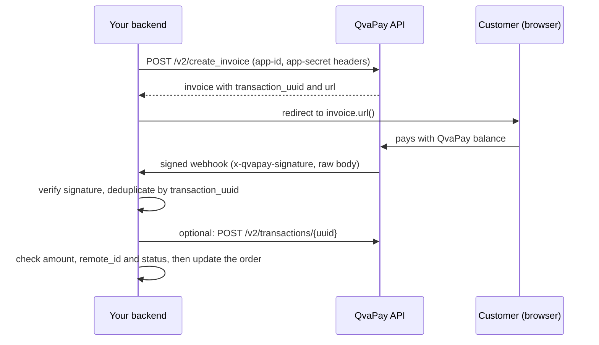

<div align="center">


**A lightweight, type-safe, framework-agnostic Java SDK for the QvaPay API.**

`Java 17+` · `Built with JDK 17 LTS` · `Maven & Gradle` · `Framework-agnostic` · `Community maintained`

[Quick start](#quick-start) · [Examples](examples/) · [API coverage](docs/api-coverage.md) · [Javadoc](https://alejo2075.github.io/qvapay-java/) · [Español](README.es.md)

</div>

> **Unofficial SDK.** This project is community maintained and is not affiliated with, endorsed by or supported by QvaPay. Official API documentation: <https://www.qvapay.com/docs>.

> **Status: `0.1.1` is available on [Maven Central](https://central.sonatype.com/artifact/io.github.alejo2075/qvapay-java).** Early release: the API follows the public QvaPay docs and has been tested offline only (see [Features](#features)).

[](https://github.com/Alejo2075/qvapay-java/actions/workflows/ci.yml) [](https://central.sonatype.com/artifact/io.github.alejo2075/qvapay-java) [](https://alejo2075.github.io/qvapay-java/)  

---

## Why this SDK?

- **Idiomatic and typed.** Immutable `record` responses, builders for requests, no `Map<String, Object>` in your code.
- **Money is `BigDecimal`.** Amounts are never rounded and keep their scale (`25.00` stays `25.00`).
- **Sync and async.** Every operation has a blocking method and an `...Async` method returning a `CompletableFuture`.
- **Safe by default.** HTTPS only, secrets redacted from `toString()` and exceptions, no redirects, and **no automatic retries of calls that create resources or move money**.
- **Signed webhooks.** HMAC-SHA256 verification over the raw bytes, with typed events for invoice payments and top-ups.
- **No framework coupling.** Plain JDK `HttpClient` and one runtime dependency (Jackson 3, kept out of the public API). Works the same in plain Java, Spring Boot, Quarkus, Micronaut or AWS Lambda.

## Features

| Feature | Since | Status |
|---|---|---|
| Merchant app: `info`, `balance` (`/v2`) | 0.1.0 | Implemented, tested offline |
| Invoices: create, modify (`/v2/create_invoice`, `/v2/modify_invoice`) | 0.1.0 | Implemented, tested offline |
| Transactions: list, detail with payer (`/v2/transactions`) | 0.1.0 | Implemented, tested offline |
| Payment authorization and direct charge (`/v2/authorize_payments`, `/v2/charge`) | 0.1.0 | Implemented, tested offline |
| Signed webhooks: invoice paid, top-up credited | 0.1.0 | Implemented, tested offline |
| User login (2FA), profile, coins, payment links | planned | Not implemented |
| P2P market | planned | Not implemented |
| Withdrawals, transfers, store | later | Not implemented, needs compliance review |

All behaviour is derived from the public QvaPay docs; see [docs/api-coverage.md](docs/api-coverage.md) for each endpoint and the open questions for QvaPay. "Tested offline" means contract tests against mocks and fixtures. **Nothing has been run against production, and none of the tests move real money.**

## Requirements

- **Java 17 or newer** (built with JDK 17 LTS, compatibility also checked on Java 21). Java 8 and 11 are not supported.
- Maven or Gradle.
- A QvaPay account and an **app** (App ID + App Secret) created in QvaPay. Use *test mode* while developing.
- App credentials belong on your **server**. Never ship the secret to a browser, mobile app or mini-app frontend.

## Installation

Available on Maven Central; no extra repositories are needed.

**Maven**

```xml
<dependency>
  <groupId>io.github.alejo2075</groupId>
  <artifactId>qvapay-java</artifactId>
  <version>0.1.1</version>
</dependency>
```

**Gradle (Kotlin DSL)**

```kotlin
repositories {
    mavenCentral()
}

dependencies {
    implementation("io.github.alejo2075:qvapay-java:0.1.1")
}
```

**Gradle (Groovy DSL)**

```groovy
repositories {
    mavenCentral()
}

dependencies {
    implementation 'io.github.alejo2075:qvapay-java:0.1.1'
}
```

Complete projects: [examples/plain-java](examples/plain-java) (Maven), [examples/gradle-java](examples/gradle-java) (Kotlin DSL), [examples/gradle-groovy](examples/gradle-groovy) (Groovy DSL).

## Quick start

Export the credentials of a **test mode** app, then run:

```bash
export QVAPAY_APP_ID=your-app-uuid
export QVAPAY_APP_SECRET=your-app-secret
```

<!-- snippet:plain-java/QuickStart.java -->
```java
public static void main(String[] args) {
    QvaPayClient client = QvaPayClient.builder()
            .appCredentials(System.getenv("QVAPAY_APP_ID"), System.getenv("QVAPAY_APP_SECRET"))
            .build();

    AppBalance balance = client.merchant().balance();
    System.out.println("Balance: " + balance.balance() + " USD");

    Invoice invoice = client.invoices().create(
            CreateInvoiceRequest.builder()
                    .amount(new BigDecimal("25.00"))
                    .description("Test invoice")
                    .remoteId("order-12345")
                    .build());

    System.out.println("Send the customer to: " + invoice.url());
    System.out.println("Keep this next to your order: " + invoice.transactionUuid());
}
```

> **Test mode.** With an app in test mode QvaPay marks the invoice as `paid` immediately and returns no payment page, so `invoice.url()` is `null` there. Outside test mode `url()` is the payment page for the customer.

Imports:

<!-- snippet:plain-java/QuickStart.java#imports -->
```java
import io.github.alejo2075.qvapay.QvaPayClient;
import io.github.alejo2075.qvapay.model.AppBalance;
import io.github.alejo2075.qvapay.model.CreateInvoiceRequest;
import io.github.alejo2075.qvapay.model.Invoice;
import java.math.BigDecimal;
```

The complete, compiling version is [QuickStart.java](examples/plain-java/src/main/java/example/QuickStart.java).

## Usage examples

### Confirm a payment on your server

<!-- snippet:plain-java/AdvancedUsage.java#transaction -->
```java
/** Confirms on the server that an invoice was really paid. */
static boolean isPaid(QvaPayClient client, String transactionUuid) {
    AppTransactionDetailResponse response = client.transactions().get(transactionUuid);
    return response.transaction().status() == TransactionStatus.PAID;
}
```

### Async

<!-- snippet:plain-java/AdvancedUsage.java#async -->
```java
static CompletableFuture<String> balanceText(QvaPayClient client) {
    return client.merchant().balanceAsync()
            .thenApply(b -> "Balance: " + b.balance() + " USD");
}
```

### Handle errors (401, 403, 429, ...)

<!-- snippet:plain-java/AdvancedUsage.java#errors -->
```java
static String describeFailure(QvaPayClient client) {
    try {
        return client.merchant().info().name();
    } catch (AuthenticationException e) {
        return "Wrong app-id/app-secret";
    } catch (PermissionDeniedException e) {
        return "Not allowed: " + e.errorCode(); // e.g. KYC_REQUIRED; branch on the code, not the text
    } catch (RateLimitException e) {
        return "Slow down, retry after " + e.retryAfter().orElse(null);
    } catch (QvaPayApiException e) {
        return "QvaPay answered HTTP " + e.statusCode();
    }
}
```

Other types: `ValidationException` (400), `NotFoundException` (404), `ServerException` (5xx), `TransportException` (network, timeout) and `SerializationException`. See [docs/troubleshooting.md](docs/troubleshooting.md).

### Verify a webhook from the raw bytes

<!-- snippet:plain-java/AdvancedUsage.java#webhook -->
```java
/**
 * Call this from your HTTP endpoint with the raw request body bytes and the two headers.
 * Throws {@code WebhookVerificationException} if the delivery must be rejected (answer 401).
 */
static InvoiceWebhookEvent handleWebhook(byte[] rawBody, String signature, String timestamp) {
    WebhookVerifier verifier = WebhookVerifier.forSecret(System.getenv("QVAPAY_APP_SECRET"));
    InvoiceWebhookEvent event = verifier.verifyInvoice(rawBody, signature, timestamp).event();
    // Now: deduplicate by event.transactionUuid(), compare amount and remoteId with your order,
    // and only then mark it as paid.
    return event;
}
```

Read the body as `byte[]` **before** any JSON binding; a re-serialized body no longer matches the signature. A runnable receiver is in [examples/webhook](examples/webhook).

### Authorize and charge a user (moves money)

> **Warning: financial effects.** `charge` debits a real user balance outside test mode, needs the user's prior consent (the SDK never grants it for them) and your app needs the `allowed_payment_auth` permission from QvaPay. It is **never retried automatically**: after a timeout the outcome is unknown, so check your transactions for the `remote_id` before charging again. `remote_id` is your reference, not an idempotency key.

<!-- snippet:plain-java/PaymentsExample.java#charge -->
```java
/** Step 1: get the URL where the user grants your app permission to charge them. */
static String consentUrl(QvaPayClient client) {
    return client.payments()
            .authorize(new AuthorizePaymentsRequest("user-001", "https://example.com/auth/callback"))
            .url(); // redirect the user's browser here; the SDK never grants consent for them
}

/** Step 2 (after the user consented): charge their balance. MOVES MONEY, never retried. */
static ChargeResponse charge(QvaPayClient client, String userUuid) {
    return client.payments()
            .charge(new ChargeRequest(new BigDecimal("10.00"), userUuid, "Monthly plan", "sub-001"));
    // If this throws TransportException the charge may or may not have happened:
    // look for remote_id "sub-001" in client.transactions().list(...) before charging again.
}
```

## Payment flow



The SDK does not host the webhook endpoint: you expose an HTTPS route in your own application and pass it the raw body and headers.

## Security

- Keep `app-secret` in environment variables or a secret manager; never in Git, logs or client code.
- Verify the signature on the **raw body** before parsing, then **deduplicate** by `transaction_uuid` and confirm amount, `remote_id` and status.
- The timestamp header is not signed: it discards stale deliveries but is not replay protection.
- Do not retry charges. Do not treat the browser redirect as proof of payment.

More in [docs/security.md](docs/security.md) and [SECURITY.md](SECURITY.md).

## Compatibility

| Environment | Notes |
|---|---|
| Maven, Gradle | Examples for each |
| Plain Java 17+ | Primary target; no framework required |
| Spring Boot, Quarkus, Micronaut | Use it as a normal library (create one `QvaPayClient` bean/singleton). No framework integration is provided |
| AWS Lambda | Java 17+ runtimes; no native integration is provided |

Jackson 3 (`tools.jackson`) is an implementation detail and does not clash with Jackson 2 (`com.fasterxml.jackson`) in your application; this is covered by a test.

## Documentation

| What | Where |
|---|---|
| Runnable examples | [examples/](examples/) |
| Endpoint coverage and open questions | [docs/api-coverage.md](docs/api-coverage.md) |
| Architecture and design decisions | [docs/architecture.md](docs/architecture.md) |
| Security guide | [docs/security.md](docs/security.md) |
| Troubleshooting / FAQ | [docs/troubleshooting.md](docs/troubleshooting.md) |
| Reference repositories studied | [docs/references.md](docs/references.md) |
| Release procedure | [docs/release.md](docs/release.md) |
| Javadoc (API reference) | <https://alejo2075.github.io/qvapay-java/> (also `./mvnw javadoc:javadoc` locally) |
| Maven artifact | [`io.github.alejo2075:qvapay-java:0.1.1`](https://central.sonatype.com/artifact/io.github.alejo2075/qvapay-java) on Maven Central |
| Official QvaPay API | <https://www.qvapay.com/docs> |

## Contributing, roadmap, license

- Contributions are welcome: read [CONTRIBUTING.md](CONTRIBUTING.md) and the [Code of Conduct](CODE_OF_CONDUCT.md).
- Roadmap: user authentication and read-only resources (coins, profile, payment links), then the P2P market. Operations that move money beyond `charge` will be added only after their contracts are confirmed.
- Licensed under the [MIT License](LICENSE).

## Disclaimer

QvaPay is a trademark of its owner. This is an independent project that is neither affiliated with nor endorsed by QvaPay. Use it at your own risk, review the code before moving money with it, and respect QvaPay's terms, KYC and compliance requirements. The SDK reflects the public documentation as of 2026-10-22 and may lag behind API changes.
